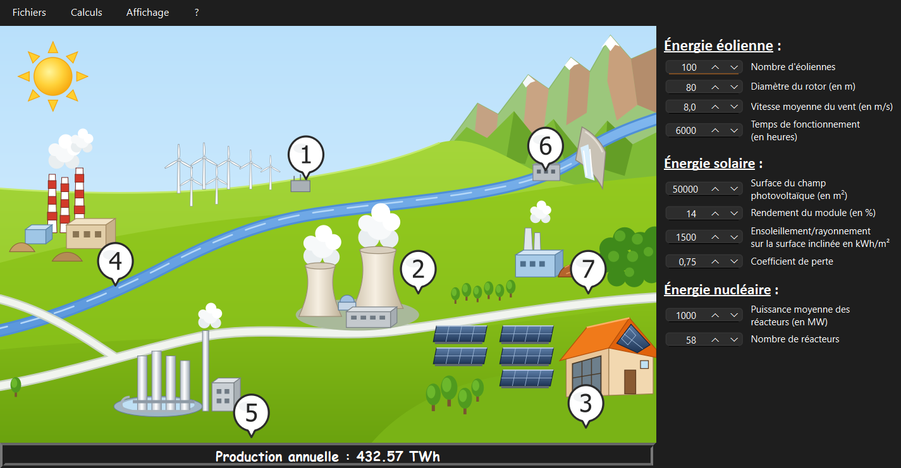
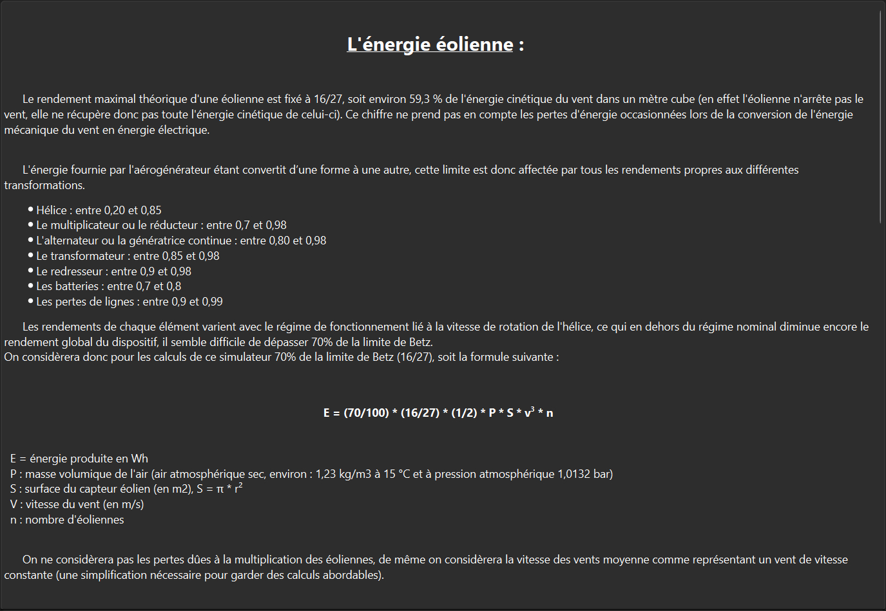
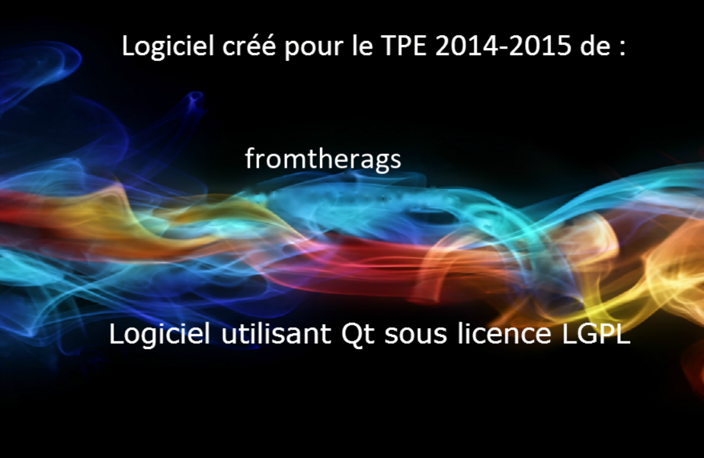

# TPE - Simulateur de Production Énergétique

Simulateur interactif de la production électrique annuelle d'un parc **éolien**, **photovoltaïque** et **nucléaire**, réalisé en 2014-2015 pour un TPE (Travaux Personnels Encadrés) et modernisé depuis. Il est écrit en **C++ / Qt 6** et fonctionne sous **Windows** et **Linux**.

- [Partie 1 — Le programme et son aspect scientifique](#partie-1--le-programme-et-son-aspect-scientifique)
- [Partie 2 — Compiler le projet](#partie-2--compiler-le-projet)

---

# Partie 1 — Le programme et son aspect scientifique

## Aperçu



*Fenêtre principale : le paysage des sept filières de production, les paramètres des trois filières simulées à droite, et la production annuelle totale en bas.*

| Fiche de calcul (menu **Calculs**) | Écran « À propos » (menu **?**) |
|---|---|
|  |  |

## Objectif

Le programme répond à une question simple : **combien d'électricité produit-on en un an** avec un nombre donné d'éoliennes, une surface de panneaux photovoltaïques et un parc de réacteurs nucléaires ? Il permet de comparer les ordres de grandeur des trois filières en modifiant leurs paramètres et en observant le résultat, recalculé à chaque changement.

La production totale affichée est la somme des trois filières :

$$E_{total} = E_{éolien} + E_{solaire} + E_{nucléaire}$$

Elle est calculée en Wh puis affichée dans l'unité la plus lisible (Wh, kWh, MWh, GWh ou TWh).

## Les trois modèles

### 1. Énergie éolienne

La puissance du vent qui traverse le rotor est $\frac{1}{2}\,\rho\,S\,v^3$. Une éolienne ne peut pas tout récupérer : si elle arrêtait complètement l'air, plus rien ne passerait. La **limite de Betz** fixe le maximum théorique à $16/27$, soit environ 59,3 %. Les pertes de la chaîne de conversion (hélice, multiplicateur, alternateur, transformateur, lignes) réduisent encore ce rendement : le simulateur retient **70 % de la limite de Betz**.

$$E_{éolien} = 0{,}70 \times \frac{16}{27} \times \frac{1}{2}\,\rho\,S\,v^3 \times n \times t$$

| Symbole | Signification | Unité |
|---|---|---|
| $\rho$ | masse volumique de l'air : 1,23 (air sec à 15 °C) | kg/m³ |
| $S$ | surface balayée par le rotor, $S = \pi (d/2)^2$ avec $d$ le diamètre | m² |
| $v$ | vitesse moyenne du vent | m/s |
| $n$ | nombre d'éoliennes | |
| $t$ | temps de fonctionnement annuel | h |

### 2. Énergie solaire photovoltaïque

$$E_{solaire} = S \times r \times H \times C_p$$

| Symbole | Signification | Unité |
|---|---|---|
| $S$ | surface du champ photovoltaïque | m² |
| $r$ | rendement des modules (14 % par exemple) | % |
| $H$ | ensoleillement annuel sur la surface inclinée (plus de 1 500 dans le sud de la France) | kWh/m² |
| $C_p$ | coefficient de perte (couramment 0,75 à 0,80) | |

Le coefficient de perte regroupe les pertes de l'installation : onduleurs (8 à 15 %), température (5 à 12 %), câbles et connexions (2 %), ombrages (0 à 50 % selon l'implantation), faible éclairement (3 à 7 %) et réflexion (environ 3 %). Avec $H$ en kWh/m², le résultat est en kWh.

### 3. Énergie nucléaire

$$E_{nucléaire} = P \times n \times 7\,451{,}1$$

| Symbole | Signification | Unité |
|---|---|---|
| $P$ | puissance moyenne d'un réacteur | MW |
| $n$ | nombre de réacteurs (58 dans le parc français de 2014) | |
| 7 451,1 | durée de fonctionnement annuelle : $24 \times 365{,}25 \times 0{,}85$ | h |

Le facteur 0,85 est le taux de disponibilité retenu : un réacteur est arrêté une partie de l'année pour maintenance et rechargement. Avec $P$ en MW, le résultat est en MWh.

## Exemple : les valeurs par défaut

Au lancement, le programme affiche **432,57 TWh**. Voici le détail :

| Filière | Paramètres par défaut | Production annuelle |
|---|---|---|
| Éolien | 100 éoliennes de 80 m de diamètre, vent de 8 m/s, 6 000 h | 0,39 TWh (environ 0,66 MW par éolienne) |
| Solaire | 50 000 m², rendement 14 %, 1 500 kWh/m², $C_p$ = 0,75 | 0,008 TWh (7,9 GWh) |
| Nucléaire | 58 réacteurs de 1 000 MW | 432,16 TWh |
| **Total** | | **432,57 TWh** |

L'ordre de grandeur obtenu pour le nucléaire est proche de la production réelle du parc français à l'époque (un peu plus de 400 TWh par an).

## Hypothèses et limites

Les modèles sont volontairement simples, pour rester au niveau d'un calcul faisable à la main :

- **Vent constant** : la vitesse moyenne est traitée comme un vent de vitesse constante. Comme la puissance dépend de $v^3$, un vent réel, variable, ne produit pas la même énergie qu'un vent constant de même moyenne.
- **Pas de puissance nominale** : une vraie éolienne ne démarre qu'à partir d'une vitesse minimale, plafonne à sa puissance nominale et s'arrête par vent trop fort. La formule, elle, croît sans limite avec $v^3$ : les grandes vitesses donnent des résultats irréalistes.
- **Pas d'effet de parc** : les pertes dues au sillage des éoliennes voisines sont ignorées.
- **Rendements fixes** : le facteur de 70 % (éolien), le coefficient de perte (solaire) et la disponibilité de 85 % (nucléaire) sont des moyennes, alors qu'ils varient selon l'installation et l'année.
- **Énergie produite uniquement** : le programme ne traite ni la consommation, ni le stockage, ni l'intermittence, ni les coûts.
- **Données de l'époque** : les données scientifiques (valeurs par défaut, rendements, parc de 58 réacteurs, part du nucléaire, cartes et sources des fiches) sont celles de 2014-2015. Elles n'ont pas été mises à jour depuis.

Les quatre autres filières dessinées dans le paysage (thermique, géothermie, hydroélectricité, biomasse) sont présentées à titre indicatif, par une infobulle, sans calcul.

## Utilisation

- **Paysage** : survoler ou cliquer une installation numérotée affiche sa description.
- **Paramètres** : chaque modification à droite recalcule la production annuelle.
- **Menu Calculs** : une fiche par filière simulée, avec la formule, ses hypothèses, ses sources et une carte (potentiel éolien, ensoleillement, centrales nucléaires françaises).
- **Menu Fichiers** : enregistrer les paramètres dans un fichier texte et les recharger. Le dossier `examples/` contient des scénarios prêts à ouvrir.

| Raccourci | Action |
|---|---|
| **F11** ou menu **Affichage > Plein écran** | Basculer en plein écran (l'image et le texte s'agrandissent) |
| **Échap** | Quitter le plein écran |
| **Ctrl+O** | Ouvrir un scénario (`.txt`) |
| **Ctrl+S** | Enregistrer les paramètres (`.txt`) |
| **Ctrl+Q** | Quitter |

---

# Partie 2 — Compiler le projet

Il faut un compilateur **C++17**, **CMake** (3.16 ou plus récent), **Ninja** et **Qt 6** avec les modules **Widgets** et **SVG**.

## Linux (Ubuntu 24.04 ou plus récent)

```bash
sudo apt-get update
sudo apt-get install -y cmake ninja-build build-essential qt6-base-dev libqt6svg6-dev libgl1-mesa-dev

cmake -B build -G Ninja -DCMAKE_BUILD_TYPE=Release
cmake --build build
./build/tpe
```

## Windows

### 1. Installer Qt

Par exemple **Qt 6.7.2 MinGW 64 bits** avec `aqtinstall` :

```powershell
winget install miurahr.aqtinstall
```

```powershell
aqt install-qt windows desktop 6.7.2 win64_mingw -O C:\Qt
```

Une installation dans `C:\Qt` est trouvée automatiquement. Pour un autre emplacement, passer `-DCMAKE_PREFIX_PATH=C:/chemin/vers/Qt` à CMake.

### 2. Compiler

**Avec CLion** (qui fournit le compilateur MinGW, CMake et Ninja) : ouvrir le dossier du projet, puis **Build** (`Ctrl+F9`) ou **Run** (`Shift+F10`).

**En ligne de commande** (PowerShell), avec les outils de CLion :

```powershell
# Mettre le compilateur, Ninja, CMake et Qt dans le PATH
$clion = "$env:LOCALAPPDATA\Programs\CLion\bin"
$env:PATH = "$clion\mingw\bin;$clion\ninja\win\x64;$clion\cmake\win\x64\bin;C:\Qt\6.7.2\mingw_64\bin;$env:PATH"

# Configurer et compiler
cmake -S . -B build -G Ninja -DCMAKE_BUILD_TYPE=Release
cmake --build build

# Copier les bibliothèques Qt à côté de l'exécutable, puis lancer
windeployqt --no-translations build\tpe.exe
.\build\tpe.exe
```

## Versions prêtes à l'emploi

À chaque push, [GitHub Actions](.github/workflows/ci.yml) compile le projet sous Linux et Windows et vérifie que l'application démarre. Pousser un tag `vX.Y.Z` publie une **Release GitHub** contenant l'archive Linux, le zip Windows portable et l'installeur Windows :

```bash
git tag v1.6.0
git push origin v1.6.0
```

---

## Licence

Copyright © 2014-2026 fromtherags.

Ce programme est un logiciel libre distribué sous la [licence publique générale GNU, version 3](LICENSE) (GPL 3). Il est fourni sans aucune garantie.

Les sources des formules sont citées dans chaque fiche du menu **Calculs**.
